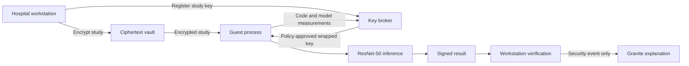

# Confidential Radiology AI

**Team Revolution | IBM Z Datathon 2026**  
**Theme 2: AI Secured - Innovation Without Exposure**

Chest X-ray inference with encrypted study storage, measurement-gated key release,
and signed results. Built and tested by the team in an IBM LinuxONE environment,
the project combines a ResNet-50 classifier with a key broker, an inference guest
process, and IBM Granite explanations of security decisions.

[Abstract](docs/Revolution_Abstract.pdf) ·
[Research deck](docs/Revolution_IBM_Z_Research_Deck.pptx) ·
[Demo video](docs/Revolution_IBM_Z_Video.mp4) ·
[Notebook](confidential-radiology-ai/project.ipynb)

## The problem

Medical-image inference needs readable pixels during computation. Encryption at rest
alone does not control which code receives those pixels. This project demonstrates a
policy-gated workflow: verify the expected code and model before releasing the study
key, perform inference, and return a small, signed answer.

The implementation follows the research deck's prototype architecture. Cryptography,
inference and policy checks run in software on LinuxONE; Secure Execution isolation
and hardware-backed attestation are simulated, as described in the deck.

## Architecture



1. **Encrypt:** AES-256-GCM protects each study with a fresh data key and binds the study
   identifier as authenticated additional data.
2. **Attest:** the broker checks the guest-code and model hashes against approved policy,
   consumes a single-use nonce, and issues an Ed25519-signed token with a 60-second lifetime.
3. **Release:** X25519 and HKDF wrap the study key for the requesting guest.
4. **Infer:** the guest decrypts the study, runs ResNet-50 and overwrites its explicit image buffer.
5. **Sign:** a schema guard restricts the result payload and the guest signs it.
6. **Verify:** the workstation checks the token, signature, model and study hashes, and timestamp.

Granite receives decision codes, pipeline stages and failed-check names. It does not
receive images or pneumonia probabilities. A faithfulness heuristic can withhold its
wording while preserving the fixed explanation.

## IBM Z integration

| Component | Project implementation |
| --- | --- |
| Platform | IBM z17, s390x big-endian, three vCPUs, approximately 7.3 GB RAM |
| Inference | Pure-PyTorch port of TorchXRayVision ResNet-50; CPU guest execution |
| Telum | Separate TensorFlow comparison using `ibm-zdnn-plugin` |
| Granite | IBM Granite 4.0 350M via llama.cpp on s390x |
| Cryptography | AES-GCM, Ed25519 and X25519 through PyCryptodome |
| Attestation | Measurement-gated process simulation |

## Results

The research deck is the submission reference for the team's LinuxONE results.
Raw JSON snapshots are available in [docs/evidence](docs/evidence/README.md).

| Measurement | Reported in the research deck |
| --- | --- |
| Security checks | 11 of 11 passed |
| Secure/clear parity | Maximum difference approximately 1.55 × 10⁻⁵; tolerance 10⁻⁴ |
| Request time | Approximately 2.5 s for the guest path versus 1.0 s clear inference |
| Security overhead | Approximately 23 ms, reported separately from process/model startup |
| Telum batch-eight acceleration | Approximately 2.1–3.6× |
| Granite generation | Approximately 5–7 s per explanation |
| Granite wording guard | One of three explanations withheld in the reported run |

The archived snapshot records one public smoke-test image for parity and Telum input.
Its batch-eight timing repeats that input. RSNA clinical accuracy is not reported in
the deck. The figures above describe the team's runs; fresh executions write their
own measurements rather than using hard-coded presentation values.

## Run on LinuxONE

Use the LinuxONE Python environment with its s390x-compatible PyTorch installation.
The recorded run used Python 3.12. Native Windows execution is not supported because
the audit module uses Linux file locking.

```bash
git clone https://github.com/anish-9387/IBM-Z-Datathon.git
cd IBM-Z-Datathon/confidential-radiology-ai
python -m pip install -r requirements.txt
python -m jupyterlab project.ipynb
```

Run the notebook with `confidential-radiology-ai/` as its working directory.

| Section | Purpose | Requirements |
| --- | --- | --- |
| 0–3 | Environment, dependencies, model/policy and broker | Python environment; network for initial downloads |
| 4 | Interactive normal and attack scenarios | Public sample or local research image |
| 4b | Granite explanations | Compatible GGUF and llama-cpp-python |
| 5 | Eleven security checks | Broker and model initialized |
| 6 | Parity, latency and ONNX inventory | Core environment |
| 6b | Telum benchmark | TensorFlow and ibm-zdnn-plugin configured for NNPA |
| 7 | RSNA split, head training and calibration | Kaggle access and accepted dataset terms |
| 8 | Results and audit verification | Results from the preceding sections |

Sections 4b, 6b and 7 depend on their respective runtime or dataset. Core inference does
not require them. Set `CRAI_GRANITE_GGUF` to the model's absolute path before starting
Jupyter. Kaggle credentials belong in the user's credential store, not the repository.

Runtime state is generated in `crai_data/`; `CRAI_HOME` can select another directory.
The model, sample, keys and policy are initialized by the notebook. Downloaded weights,
credentials and runtime state are excluded from Git.

## Result contract

The five-field payload follows the research deck. This example illustrates the schema;
it is not a new inference result:

```json
{
  "schema": "crai.result.v1",
  "study_hash": "aaaaaaaaaaaaaaaaaaaaaaaaaaaaaaaaaaaaaaaaaaaaaaaaaaaaaaaaaaaaaaaa",
  "model_hash": "bbbbbbbbbbbbbbbbbbbbbbbbbbbbbbbbbbbbbbbbbbbbbbbbbbbbbbbbbbbbbbbb",
  "pneumonia_probability": 0.0067,
  "time": 1792200000
}
```

`time` is a Unix timestamp in seconds. Probability is numeric and rounded to four
decimal places. The payload travels inside an envelope containing its signature and
attestation token. Extra fields are rejected. Refusals carry a named reason code.

## Tests

Notebook section 5 exercises altered models/code, ciphertext truncation, tag tampering,
expired tokens, vault modification, unexpected output fields, replay, request limiting,
audit edits and guest socket blocking.

Run the focused result-contract and signature tests with:

```bash
cd confidential-radiology-ai  # from the repository root
python -m unittest discover -s tests -v
```

## Repository structure

```text
confidential-radiology-ai/
  project.ipynb       Main demo and evaluation notebook
  requirements.txt   Core dependencies
  crai/              Inference, broker, cryptography, UI and evaluation
  tests/             Result-contract and signature regression tests
  deploy/            Container deployment definitions
  confidential-radiology-ai-pitch.mp4
docs/
  Revolution_Abstract.pdf
  Revolution_IBM_Z_Research_Deck.pptx
  SECURITY.md        Prototype trust boundaries
  evidence/          Recorded LinuxONE result snapshots
  visuals/           Presentation illustrations
```

## Prototype scope

The deck distinguishes real LinuxONE execution from simulated host isolation. The
broker uses file-backed keys, guest measurements are self-reported, and the socket
guard runs inside the process. The guest runs CPU inference; Telum is benchmarked
separately. Explicit buffer wiping cannot guarantee removal of every Python memory
copy. See [security scope](docs/SECURITY.md) for the implementation boundaries.

This is a research prototype, not a diagnostic device. The backbone's pretraining mix
includes RSNA, which matters when interpreting RSNA evaluation.

## Team Revolution

Anish Mall · Sourav Kumar · Aashi Soni · Ayush Kesarwani · Gobinath
